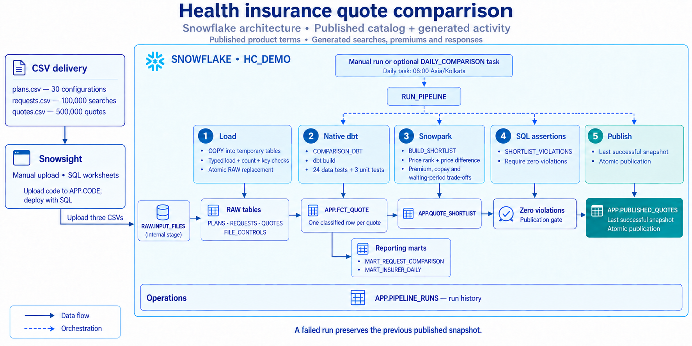
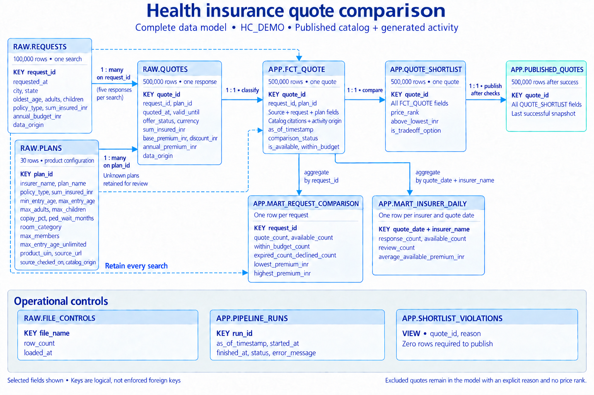

# Health insurance quote comparison

A Snowflake project that turns insurance search requests and insurer responses into a trustworthy, explainable comparison dataset. Setup, loading, deployment and execution are performed manually in Snowsight using the supplied files and SQL worksheets.

**Data provenance:** the catalog contains five real Indian insurers and published product terms, normalized into 30 configurations. The 100,000 searches and 500,000 quote responses—including premiums, declines and source errors—are generated scenarios. They are not actual insurer offers or Policybazaar transactions. Source references travel with the catalog; activity rows are explicitly marked `GENERATED_SCENARIO`. This project has no affiliation with the named companies.

## The business problem

Imagine a person searching for ₹10 lakh of health insurance within an annual budget of ₹15,000. A comparison marketplace receives prices from several insurers. Before presenting those prices, it needs to establish whether each response is usable: does the plan cover the requested amount, accept the household and age, have a consistent payable premium, and remain valid at the time of comparison?

Sorting every response by price can put an expired, declined or incorrect quote at the top. Even among valid responses, the cheapest plan may have a higher copay or a longer waiting period. A useful comparison must explain these differences rather than equate the lowest price with the best policy.

This project answers three practical questions:

1. Which quote responses can be shown for each search, and why are others excluded?
2. How do the available offers compare on annual premium, copay and waiting period?
3. Where do unusable responses occur, and how many searches still have options within budget?

In a live marketplace, these checks would protect customers from unusable comparisons. Here, generated activity exercises that workflow at volume. The resulting insurer summaries describe this delivery only; they cannot measure the named insurers' actual service quality or market prices.

The output is a comparison dataset, not policy issuance, claims processing or a medical recommendation. Five quotes for one search are competing responses, not five purchases. Adding their premiums together would not measure revenue.

## An example from the delivered CSVs

These are **generated activity records present in the delivered CSVs**, joined to published catalog terms. Search `REQ-000001` represents one adult aged 35 in Mumbai, requesting an individual policy with ₹10 lakh cover and a ₹15,000 annual budget. At `2026-09-20 12:00:00` Indian local time, all five responses below pass the modeled availability checks.

| Quote ID | Insurer / selected product | Generated annual premium | Published base copay | PED waiting period | Within budget |
| --- | --- | ---: | ---: | ---: | --- |
| QTE-0000001 | HDFC ERGO / Optima Secure | ₹12,595 | 0% | 36 months | Yes |
| QTE-0000002 | Niva Bupa / ReAssure 2.0 Platinum+ | ₹12,785 | 0% | 36 months | Yes |
| QTE-0000003 | Care Health / Care Supreme | ₹14,245 | 0% | 36 months | Yes |
| QTE-0000005 | ICICI Lombard / Elevate | ₹14,316 | 0% | 36 months | Yes |
| QTE-0000004 | Star Health / Young Star Silver | ₹17,402 | 0% | 12 months | No |

Copay is the share of an admissible claim borne by the insured; PED means pre-existing disease. The table uses the selected base configurations, with no optional copay or waiting-period reduction. The premiums are generated values, not published insurer tariffs.

HDFC ERGO has the lowest generated price in this search. Niva Bupa and Care have the same modeled copay, waiting period and room category, so they are not marked as trade-off options by this limited comparison. ICICI and Star share a single-private-AC-room category: Star's shorter PED wait is a trade-off against its higher generated price. Both remain trade-off options. Room categories differ from the other three products, so the algorithm does not compare dominance across those categories. An over-budget response remains available if it passes the other checks.

Actual products have additional benefits and restrictions that are not captured here. A price rank or trade-off flag therefore does not establish which real policy someone should buy.

The activity also contains specific unusable responses. These defects are generated scenarios, not errors observed in any insurer's systems:

| Generated source record | What the CSV contains | What the solution does |
| --- | --- | --- |
| QTE-0000008 | Base ₹30,145, discount ₹904, payable ₹29,341 | Classifies `INVALID_AMOUNT`: base minus discount is ₹29,241. Preserves the source amount and excludes the quote. |
| QTE-0000013 | `DECLINED` with blank premium fields | Keeps the response as `DECLINED`; does not interpret a missing price as zero. |
| QTE-0000094 | Plan ID `UNRESOLVED-PLAN` | Classifies `INVALID_REFERENCE`; retains the response so it can be investigated. |

The first record is also expired at the example snapshot. Each quote receives the first applicable reason in a documented precedence order, so its recorded reason is `INVALID_AMOUNT`.

## What each input file contains

There is one CSV per business entity. No Excel source or alternate monthly copy needs to be loaded.

| File | Rows | One row represents | Main fields |
| --- | ---: | --- | --- |
| `data/plans.csv` | 30 | A published product configured for a household type and coverage amount | Plan ID, insurer, product UIN, cover, entry ages, household limits, copay, waiting period, room category and source references |
| `data/requests.csv` | 100,000 | One generated insurance search | Request ID, search time, city/state, oldest adult age, household, requested cover, annual budget |
| `data/quotes.csv` | 500,000 | One generated response to a search | Quote/request/plan IDs, response and expiry times, offered/declined status, currency, cover, premium and discount |
| `data/manifest.json` | Metadata | Reference metadata for the fixed delivery | Catalog/activity origins, delivery version, snapshot time, row counts and reference SHA-256 fingerprints |

A request ID appears five times in `quotes.csv`, once for each insurer response. Quote IDs are unique. A plan ID appears in many responses because many people can request the same product. These relationships are expected, not duplicate business events.

### Published catalog and its sources

The catalog was checked on **September 20, 2026**. Each product is expanded into individual and family-floater configurations at ₹10 lakh, ₹15 lakh and ₹25 lakh: five products × two types × three amounts = 30 rows. These are configurations of five products, not 30 distinct products.

| Insurer and selected product | Document UIN | Maximum adult entry age | Floater limits: adults / children / total | Source |
| --- | --- | --- | --- | --- |
| HDFC ERGO — my:Optima Secure, Optima Secure variant | HDFHLIP25041V062425 | No maximum | 4 / 6 / 10 | [Published prospectus](https://www.hdfcergo.com/docs/default-source/downloads/prospectus/health/my-optima-secure-prospectus.pdf) |
| Niva Bupa — ReAssure 2.0, Platinum+ | NBHHLIP27054V032627 | 99 | 6 / 5 / 6 | [Published prospectus](https://transactions.nivabupa.com/pages/doc/prospectus/ReAssure-2.0-Prospectus-cum-Sales-Literature.pdf) |
| Care Health — Care Supreme | CHIHLIP27061V032627 | 99 | 2 / 2 / 4 | [Product terms](https://www.careinsurance.com/product/care-supreme), [UIN reference](https://selfcare.careinsurance.com/premium-revision) |
| Star Health — Young Star Insurance Policy, Silver | SHAHLIP26043V062526 | 40 | 2 / 3 / 5 | [Published prospectus](https://d28c6jni2fmamz.cloudfront.net/Prospectus_Young_Star_Insurance_Policy_V_8_f21b6037ff.pdf), [customer information sheet](https://d28c6jni2fmamz.cloudfront.net/CIS_Young_Star_Insurance_Policy_V_1_Static_275812a135.pdf) |
| ICICI Lombard — Elevate | ICIHLIP27057V062627 | 125 | 2 / 3 / 5, selected online distribution scope | [Published prospectus](https://www.icicilombard.com/docs/default-source/default-document-library/elevate-prospectus_.pdf), [Policybazaar family listing](https://www.policybazaar.com/insurance-companies/icici-lombard-health-insurance/family/) |

The UIN identifies the referenced product version. This is a pinned reference catalog, not a promise that each document is the latest version available for purchase. Insurers may change the documents behind these URLs. `product_uin`, `source_url`, `source_note` and `source_checked_on` record exactly which reference and scope informed the stored values.

The first three selected configurations use the normalized room category `AT_ACTUALS`; Star and ICICI use `SINGLE_PRIVATE_AC_ROOM`. These labels summarize the cited room provisions, not every policy restriction. All selected base configurations have zero copay; optional copay, deductibles, room modifiers and PED reductions are excluded. The published PED waits are 36 months except Young Star's 12 months.

Catalog scope matters when interpreting eligibility:

- Individual rows select one adult. This does not claim that an insurer cannot cover multiple people on an individual basis.
- The comparison starts at adult age 18. Child-only policies, individual child ages, relationships, medical disclosures and underwriting decisions are not modeled.
- Floater checks enforce adult, child **and total-member** limits. For example, Niva Bupa's selected configuration allows no more than six people in total, even though its separate adult and child caps add to more than six.
- A blank maximum age means unrestricted only when `max_entry_age_unlimited` is explicitly true. An unexplained missing limit fails the source assertion.
- `AVAILABLE` means the response passes the rules implemented here. It does not establish complete policy eligibility or insurer acceptance.

City/state names and published catalog references are real. Request IDs, quote IDs, prices, dates and outcomes describe generated activity; no real customer identities are included. Internal `plan_id` values are project keys, not insurer-issued product identifiers.

### Scope of the supplied data

The supplied files are the complete fixed delivery. Searches span September 1–19, 2026 across 12 Indian cities. Ages range from 18 to 75; policy types are individual and family floater; coverage choices are ₹10 lakh, ₹15 lakh and ₹25 lakh. All timestamps are Indian local wall time stored as `TIMESTAMP_NTZ`. The initial comparison time is fixed at `2026-09-20 12:00:00` to keep results reproducible.

Premiums vary with coverage, age, household, a city multiplier and an insurer multiplier. The supplied prices include variation and a 0%, 3%, 5% or 8% discount. Amounts are generated in whole INR and stored in decimal columns. This formula is an illustrative assumption, not an actuarial model, an observed market distribution or a tax calculation. Separate GST, add-ons, hospital networks, underwriting disclosures and detailed exclusions are outside this dataset.

Approximately 3% of responses are declined, 1% have inconsistent payable amounts, 0.5% reference an unknown plan, and 0.5% have inconsistent coverage. Those are explicit source scenarios. Age ineligibility and expiry follow from the ordinary request/plan values and the seven-day validity window. There are no real personal identifiers or diagnoses.

Upload the existing CSVs unchanged; no data generation is part of setup. `manifest.json` documents this delivery and distinguishes `PUBLISHED_REFERENCE` catalog data from `GENERATED_SCENARIO` activity. It is not uploaded or read by the pipeline. Its SHA-256 values are reference fingerprints, not a claim that the SQL loader verifies file-byte hashes.

## Processing flow

[](docs/images/architecture.png)

*Architecture of the implemented pipeline. Open the image to view it at full size.*

Use Snowsight to upload the three CSVs to `RAW.INPUT_FILES` and the dbt, Snowpark and output-check files to `APP.CODE`. Run the supplied SQL in worksheets to provision objects, load the delivery, create the native dbt project and procedures, and execute the pipeline. The runbook specifies every stage path and the execution order.

`sql/02_load_data.sql` copies exact filenames into typed temporary tables, verifies 30 plan rows, 100,000 requests and 500,000 quotes with unique non-null keys, then replaces all three source tables and their count controls in one transaction. Repeating the load does not append duplicate rows. Perform loads, manual pipeline runs and deployments one at a time. Suspend scheduling and wait for any active run to finish before starting manual work; the scripts do not enforce mutual exclusion.

Native dbt builds the models and runs the assertions. Snowpark then computes the shortlist using warehouse joins and window operations, without collecting the quote table into a Python list. An independent SQL check verifies its result. Only a successful run replaces `PUBLISHED_QUOTES`, in a transaction. Failed runs leave the previous publication available. Intermediate models and reporting marts are working tables and can reflect an unsuccessful attempt; consumer comparisons should read the published table.

### Classification and comparison rules

`FCT_QUOTE` evaluates these reasons in order:

1. Missing request or plan → `INVALID_REFERENCE`.
2. Declined response → `DECLINED`; another unsupported status → `INVALID_STATUS`.
3. Missing, nonpositive or inconsistent offered price → `INVALID_AMOUNT`.
4. Non-INR or missing currency → `INVALID_CURRENCY`.
5. Quoted coverage differs from the request or plan → `COVER_MISMATCH`.
6. Household type or member limits differ → `HOUSEHOLD_MISMATCH`.
7. Age is outside the plan's inclusive entry range → `AGE_INELIGIBLE`.
8. Missing dates or impossible chronology → `INVALID_DATES`.
9. Expiry is at or before the comparison time → `EXPIRED`.
10. Otherwise → `AVAILABLE`.

Available quotes get a price rank within their request, with quote ID breaking price ties. `above_lowest_inr` shows the additional premium over that request's cheapest available offer.

`is_tradeoff_option` is true unless another available quote for the same request and room category has an equal or lower price, copay and waiting period, with at least one strictly better value. Equal offers remain alternatives. This transparent rule compares only the modeled terms; it does not assign a universal “best policy.” Excluded quotes remain in the output with no price rank and a false trade-off flag.

## Data model

[](docs/images/data-model.png)

*All 11 tables and views, with selected fields and logical relationships. Open the image to view it at full size.*

These are logical relationships. An unknown plan is deliberately possible in raw quote data; it is classified rather than removed by a foreign-key constraint.

The tables follow a search from its original requirements to a checked comparison result. The `RAW` tables hold the supplied inputs. The `APP` tables add business decisions, comparison details and summaries. For a comparison screen or a downstream application, read `APP.PUBLISHED_QUOTES`, which contains the last result that passed all checks.

| Snowflake object | What one row represents | What the object contains and how it is used |
| --- | --- | --- |
| `RAW.PLANS` | One insurance product configuration, identified by `plan_id` | This is the reference catalog used to understand what a quoted plan offers and whom it can cover. It stores the insurer and product name, coverage amount, individual or family policy type, age and family-size limits, copay, waiting period and room category. It also keeps the published source references so someone can trace the stored terms. The pipeline uses this table to check whether a response matches the search requirements; it does not contain customer quotes or purchased policies. |
| `RAW.REQUESTS` | One generated insurance search, identified by `request_id` | This table records what the person in each scenario is looking for: where they live, their household size, the oldest adult's age, the requested policy type and coverage, their annual budget and when the search occurred. For example, it can describe a family seeking ₹10 lakh of cover within a stated budget. These requirements provide the context for evaluating every response to that search. |
| `RAW.QUOTES` | One generated response to a search, identified by `quote_id` | This table preserves each supplied response, including its request and plan identifiers, offered or declined status, premium, discount, coverage and validity period. It deliberately retains expired responses and source errors so the pipeline can explain why a response cannot be used. Five rows for one request represent five competing responses, not five purchases; at this stage, the table has not decided which responses are suitable for comparison. |
| `RAW.FILE_CONTROLS` | One loaded source CSV, identified by `file_name` | This table records the verified row count and load time for each of the three source files. An operator uses it to confirm that the expected delivery was loaded—for example, that `quotes.csv` contributed 500,000 rows. Loading again replaces these entries, so this is the current delivery's load record rather than a history of every upload. |
| `APP.FCT_QUOTE` | One evaluated quote response, identified by `quote_id` | This table brings together the original response, the search requirements and the matching plan's published terms, so a response can be understood without separately reading three source tables. It evaluates the response at the selected comparison time and records whether it is available, whether it is within budget and, if excluded, the primary reason such as expiry or an inconsistent premium. It retains every response, including those with an unresolved plan, along with the data-origin labels and available catalog references. Use it to answer questions such as “Why was this quote excluded?” or “Does this available offer meet the search's budget?” |
| `APP.MART_REQUEST_COMPARISON` | One search summary, identified by `request_id` | This table summarizes the choices available for each search. It shows how many responses arrived, how many are available, how many available responses fit the budget, how many were classified as expired or declined, and the lowest and highest available premiums. It retains searches even if they have no responses. Use it to identify searches with no usable options or no affordable options; a missing premium range means there are no available prices to summarize. |
| `APP.MART_INSURER_DAILY` | One insurer's responses for one quote creation date | This table groups responses by insurer and the date they were issued. It reports the total responses, those available at the selected comparison time, those needing source-data review, and the average premium among available responses. Responses whose plan cannot be matched appear under `UNKNOWN_PLAN` rather than being assigned to an insurer. Use it to investigate patterns in this supplied delivery; because the activity is generated, these figures do not measure an insurer's real service quality or market pricing. |
| `APP.QUOTE_SHORTLIST` | One quote response with comparison results, identified by `quote_id` | This is Snowpark's working result before publication. It keeps all the information from `FCT_QUOTE` and adds a price rank within the search, the extra premium above the cheapest available offer, and a flag showing whether the offer remains a trade-off option under the modeled price, copay and waiting-period rules. Despite its name, it keeps excluded responses too; those receive no price rank and a false trade-off flag. Use it to inspect the comparison calculations while the pipeline checks whether the result can be published. |
| `APP.PUBLISHED_QUOTES` | One quote response in the latest successfully checked comparison | This is the table a comparison screen or downstream application should read. It contains the checked shortlist result, including available offers, their comparison details and excluded responses with their reasons; filter `is_available = TRUE` when displaying usable offers. The pipeline replaces it only after all required checks pass, so a failed later run leaves the previous successful result available. It stores one published snapshot, not the history of every comparison run. |
| `APP.SHORTLIST_VIOLATIONS` | One detected output problem, identified by a quote and a reason | This is a diagnostic view, not another copy of the quote dataset. It reports rows that break the output assertions, allowing an operator to see the affected quote and the reason for the failure. Zero rows means these assertions found no problems; any returned row prevents the new comparison result from being published. Use this view when a pipeline run fails its Snowpark output checks. |
| `APP.PIPELINE_RUNS` | One recorded pipeline execution, identified by `run_id` | This table records the comparison time requested for a run, when execution started and finished, its status and any captured error message. An operator uses it to check whether a run succeeded and investigate failures. A run is recorded after its input timestamp passes validation, so an invalid timestamp can be rejected before a row is created. This table stores execution history, not copies of the quotes produced by each run. |

For example, the inconsistent premium in `QTE-0000008` stays unchanged in `RAW.QUOTES`. `APP.FCT_QUOTE` marks it `INVALID_AMOUNT`, and `APP.QUOTE_SHORTLIST` retains it without a price rank. Once the complete result passes its assertions, `APP.PUBLISHED_QUOTES` also retains that response and its exclusion reason. This allows the application to exclude it from available offers while preserving an explanation for investigation.

In the insurer summary, `review_count` counts invalid source responses or coverage mismatches. Ordinary expiry, decline, age and household exclusions do not contribute to this metric. The request and insurer summaries are rebuilt during processing and can reflect an unsuccessful attempt; only `APP.PUBLISHED_QUOTES` is protected by the final publication step.

## Assertions and verification

`dbt/tests/` contains six singular SQL assertions. Each returns **violating rows**: zero rows passes; one or more rows fails. Comments in every file describe the assertion and its result. Checks cover source preservation, usable quote requirements, flags, source contracts, request summaries and insurer summaries.

`dbt/models/schema.yml` and `sources.yml` add 18 generic data tests, including unique keys, required keys, accepted statuses and request relationships. `dbt/models/unit_tests.yml` contains three fixture-based unit tests with explicit expected output. They cover classification boundaries, the separation between eligibility and budget, explicitly unlimited entry age and total-family limits. Together, native `dbt build` selects 24 data tests and three unit tests.

All retained tests execute as part of the native dbt build in Snowflake. The unit tests pin their own comparison timestamp so their fixtures stay repeatable when the pipeline time changes. `sql/04_output_checks.sql` defines the independent Snowpark output assertion view; the pipeline installs it after its input tables exist and requires zero violations before publication.

At the fixed initial snapshot, the complete delivered dataset produces:

| Classification | Quote rows |
| --- | ---: |
| AVAILABLE | 137,861 |
| EXPIRED | 264,157 |
| AGE_INELIGIBLE | 57,282 |
| HOUSEHOLD_MISMATCH | 15,846 |
| DECLINED | 14,881 |
| INVALID_AMOUNT | 5,032 |
| COVER_MISMATCH | 2,484 |
| INVALID_REFERENCE | 2,457 |
| **Total** | **500,000** |

Other modeled reasons have zero rows in this delivery. Advancing the snapshot changes expiry and availability without changing source premiums. The optional daily task uses the current Indian local time, so its counts will differ; the fixed dataset does not replenish itself.

## Repository layout and next step

```text
health-insurance-comparison/
├── README.md                 # Business problem, data sources and data model
├── RUNBOOK.md                # Manual Snowsight setup, execution and recovery
├── data/                     # Three supplied CSVs and reference manifest
├── docs/images/              # Architecture and data-model images
├── sql/
│   ├── 01_setup.sql          # Role, warehouse, schemas, stages and source tables
│   ├── 02_load_data.sql      # Typed loading, count/key checks and raw replacement
│   ├── 03_deploy.sql         # Native dbt project and Snowpark procedure
│   ├── 04_output_checks.sql  # Upload only; pipeline installs the assertion view
│   ├── 05_pipeline.sql       # Orchestration procedure and suspended daily task
│   └── 99_cleanup.sql        # Remove the complete Snowflake deployment when finished
├── dbt/
│   ├── dbt_project.yml       # Model settings and fixed default comparison time
│   ├── profiles.yml          # Native Snowflake target using session identity
│   ├── models/               # Three models, schema tests and unit fixtures
│   └── tests/                # Six SQL assertions returning violating rows
└── snowpark/
    └── shortlist.py          # Python module executed inside Snowflake
```

Follow [RUNBOOK.md](RUNBOOK.md) to upload the supplied files, provision Snowflake and run the project. The guide contains only Snowsight actions and SQL worksheet commands. A successful native run and the documented output checks must be verified in the target account; this repository does not imply that deployment has already occurred.

When retiring the project, follow runbook step 14 and execute [sql/99_cleanup.sql](sql/99_cleanup.sql). It removes `HC_DEMO` and all its contents—including stages, uploaded files and the native dbt project—plus `HC_WH` and `HC_ENGINEER`. Cleanup is separate from normal setup and execution.
